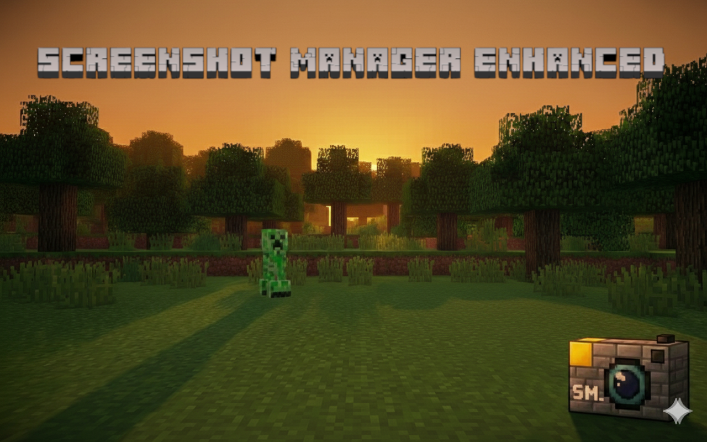

<!--  -->

A mod designed to keep your Minecraft screenshots organized automatically. Say goodbye to a cluttered **screenshots** folder! This mod intelligently sorts your screenshots into folders based on the world, dimension, date, or a combination of these.

## ✨ Features

* **Automatic Organization**: Screenshots are instantly sorted into subfolders upon capture.
* **In-Game Gallery** 📸: Browse, inspect metadata, manage, and share your screenshots directly from within Minecraft.
* **Per-World Configuration**: Customize settings for your single-player or specific server worlds.
* **In-Game Configuration**: Unified settings UI powered by [YetAnotherConfigLib (YACL)](https://modrinth.com/mod/yacl) and [Mod Menu](https://modrinth.com/mod/modmenu), complete with live folder previews and path validation.
* **Flexible Grouping Modes**: Customize how you want your folders structured. The mod generates paths based on your current context.
  * **`WORLD`** (Default): Groups screenshots by the world or server name.
    * Example: `screenshots/My_Survival_World/`
  * **`DATE`**: Groups screenshots by the current date (`yyyy-MM-dd`).
    * Example: `screenshots/2025-01-30/`
  * **`WORLD_DIMENSION`**: Groups by World, then by Dimension.
    * Example: `screenshots/My_Survival_World/minecraft_overworld/`
    * Example: `screenshots/My_Survival_World/minecraft_the_nether/`
  * **`WORLD_DATE`**: Groups by World, then by Date.
    * Example: `screenshots/My_Survival_World/2025-01-30/`
  * **`WORLD_DIMENSION_DATE`**: A three-level hierarchy: World -> Dimension -> Date.
    * Example: `screenshots/My_Survival_World/minecraft_the_end/2025-01-30/`
  * **`WORLD_DATE_DIMENSION`**: A three-level hierarchy: World -> Date -> Dimension.
    * Example: `screenshots/My_Survival_World/2025-01-30/minecraft_the_nether/`
  * **`NONE`**: Disables grouping. Screenshots are saved directly in the screenshots folder (standard Minecraft behavior).
    * Example: `screenshots/`

### 📸 In-Game Gallery

Manage your moments without leaving the game! Open the gallery directly from the Minecraft Pause Menu (**Gallery 📸**).

* **Paginated Grid & Folder Browsing**: View screenshots sorted newest-first in a responsive, paginated grid (`3`, `6`, or `8` columns) with aspect-ratio-preserving thumbnails powered by an async LRU texture cache.
* **Keyboard Navigation**: Navigate thumbnails with `Arrow` keys, jump pages with `PageUp`/`PageDown`, press `Enter` to open the selected screenshot, and use `Left`/`Right` arrows in single-image view. Your selection and page are preserved when returning to the grid.
* **Metadata Inspector (`I`)**: Toggle the **Info** panel (button or `I` key) in the single-image view to inspect embedded Minecraft metadata (world, dimension, biome, one-click copyable coordinates, difficulty, days played, world age, MC version, player, game mode) alongside image resolution, file size, and modified timestamp.
* **Organize & Share**: Copy screenshots directly to your clipboard with **Copy**, move unwanted shots to your OS Trash/Recycle Bin with **Delete**, or jump straight to the directory with **Open Folder**.

### ⚗️ Advanced Features

* **Metadata Support** 🗃️: Automatically embeds rich game details directly into the screenshot file (XMP format). This data travels with the image and can be viewed in-game via the Gallery's **Info** inspector or in external tools!
  * **World Context**: World Name, Dimension, Biome
  * **Location**: Exact X, Y, Z Coordinates (with one-click copy in the Gallery Inspector)
  * **Time**: In-game Days Played, World Age
  * **Game State**: Difficulty, Game Mode, Player, Minecraft Version
* **Custom Save Location** 💾: Choose exactly where your screenshots go.
  * Override the default `.minecraft/screenshots` location.
  * Use any absolute path on your system (e.g., a shared network drive or cloud storage folder) with live directory writability validation.
  * *Note: Enabling requires acknowledging the world-name conflict warning.*

## 📥 Installation

### Option 1: Modrinth (Recommended)

The easiest way to install **Screenshot Manager Enhanced** is through the Modrinth Launcher or Download from the Modrinth website.

1. Visit our [Screenshot Manager Enhanced on Modrinth](https://modrinth.com/mod/screenshot-manager-enhanced).
2. Click **Install** (if using the app) or download the version matching your Minecraft instance.
3. Ensure you have the required dependencies installed.

## Option 2: Manual Install (GitHub)

For those who prefer the manual route:

1. **Install Fabric Loader**: Make sure you have the [Fabric Loader](https://fabricmc.net/use/installer/) installed for your version of Minecraft.
2. **Download Dependencies**: You will need the following mods:
    * [Fabric API](https://modrinth.com/mod/fabric-api)
    * [YetAnotherConfigLib (YACL)](https://modrinth.com/mod/yacl) (Required for configuration screen)
    * [Mod Menu](https://modrinth.com/mod/modmenu) (Recommended for accessing settings)
3. **Download Mod**: Go to the [GitHub Releases](#) page and download the latest `.jar` file.
4. **Install**: Drop the `.jar` files into your `.minecraft/mods` folder.
5. **Launch**: Start Minecraft and enjoy organized screenshots!

## 🖼️ Gallery

Check out our [Gallery](Gallery.md) to see examples of:

* Grouping Modes (World, Date, Dimension)
* Metadata embedding
* Mod Menu configuration

## ⚙️ Usage & Configuration

Once installed, the mod works automatically with the default setting (Group by `WORLD`).

To change the settings:

1. Open the Pause Menu or Main Menu.
2. Click on the **Mods** button (requires Mod Menu).
3. Search for **Screenshot Manager Enhanced** and click the **Config** button to open **SME Settings**:
   * **Grouping Mode**: Pick your preferred folder organization mode with live example folder path previews.
   * **Metadata**: Toggle **Embed Screenshot Metadata** to store world, biome, and coordinate XMP data in new screenshots.
   * **Custom Save Location**: Enable and specify a custom writable directory (requires acknowledging the conflict warning).
4. **World Overrides**: Customize specifics for your favorite servers or worlds *(Coming Soon)*.

## 🤝 Contributing

We welcome contributions!

1. **Fork the Repository**
2. **Clone**: `git clone https://github.com/milezerosoftware/screenshot-manager-enhanced.git`
3. **Make Changes**: Core logic resides in `common/`. Loader-specific code is in `fabric/`.
4. **Test**: Run unit tests with `./gradlew :common:test -Pmc_ver=26.2` or run client locally with `./gradlew :fabric:runClient -Pmc_ver=26.2`.
5. **Pull Request**: Submit a PR targeting `main` with a clear description of your changes.

Please report any bugs or feature requests on the [Issue Tracker](https://github.com/milezerosoftware/screenshot-manager-enhanced/issues).

### 🛠️ Building from Source

This project uses a multi-module Gradle structure to support multiple Minecraft versions dynamically.

#### Build All (Recommended)

Build all configured Minecraft versions for Fabric in one command:

```bash
./gradlew buildAllFabric
```

#### Run Unit Tests

Run unit tests across common components:

```bash
# Run tests for specific MC version
./gradlew :common:test -Pmc_ver=26.2

# Or against Java 21 baseline target
./gradlew :common:test -Pmc_ver=1.21.11
```

#### Build Specific Version

To build or run for a specific Minecraft version, pass the `-Pmc_ver` property:

```bash
# Build Fabric for MC 26.2
./gradlew :fabric:build -Pmc_ver=26.2

# Run client for testing in MC 26.2
./gradlew :fabric:runClient -Pmc_ver=26.2
```

> [!NOTE]
> Supported Minecraft versions are defined dynamically by property files in `versionProperties/` (e.g. `1.21.11`, `26.1.2`, `26.2`). The build system automatically detects and builds active versions.

## 🚀 Release Process

Releases use a guided two-phase Gradle workflow (`prepareRelease` and `publishRelease`) with dry-run and Modrinth sandbox support:

``` text
┌──────────────────────────────────────────────────────────────┐
│                  TWO-PHASE RELEASE WORKFLOW                  │
├──────────────────────────────────────────────────────────────┤
│  PHASE 1: PREPARATION                                        │
│  1. ./gradlew prepareRelease                                 │
│     - Detects version bump & synthesizes CHANGELOG.md        │
│     - Creates release/vX.Y.Z branch & updates gradle.properties│
│     - Pushes branch and opens a Pull Request targeting main  │
│  2. Review and merge the Pull Request on GitHub              │
│                                                              │
│  PHASE 2: PUBLISHING (on main after merge)                   │
│  3. git checkout main && git pull                            │
│  4. ./gradlew publishRelease                                 │
│     - Builds all MC versions (./gradlew buildAllFabric)      │
│     - Creates & pushes git tag vX.Y.Z                        │
│     - Creates GitHub Draft Release & uploads to Modrinth     │
│     - Publishes the GitHub Release                           │
└──────────────────────────────────────────────────────────────┘
```

📖 **For full instructions**, see [RELEASE.md](RELEASE.md).

## 📄 License

This project is licensed under the [Apache-2.0 License](LICENSE).
